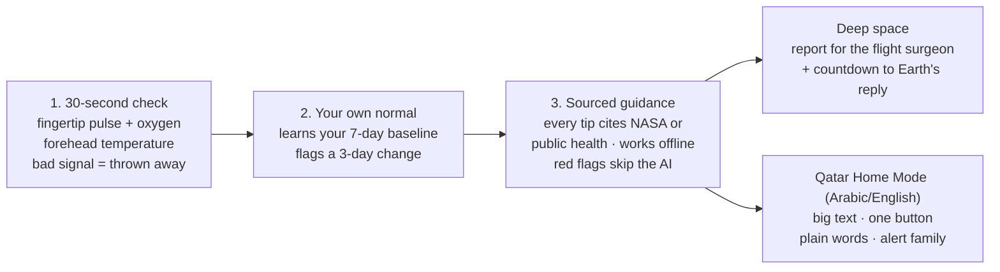

# Slides: Baseera (بصيرة), by Team Baseera

**Team and project:** **Baseera (بصيرة)**: Arabic for *insight*, seeing clearly.
**Presenters:** **Abdullah** (hook, Qatar) and **Sulaiman** (how it works, close, all Q&A).
**Spoken script:** [PITCH_SCRIPT.md](PITCH_SCRIPT.md) (about 2:52 inside a 3:00 slot, opening with a short staged dizzy spell) · **Sources:** [docs/CONTENT_REVIEW.md](../docs/CONTENT_REVIEW.md)
**Memory anchor:** **`Personal. Sourced. Immediate.`**

---

## 1. Rules for every slide

- **Light background, high contrast:** off-white `#F8FAFC`, navy text `#0B1426`, teal accent `#0E7490`, status pills `✓ OK` green, `! Watch` amber, `✕ Act` red. App screenshots (dark theme) go inside laptop frames.
- **No videos, no `Alt+Tab`:** the projector shows only these slides; the live app is on the judges' desk laptop.
- **One idea per slide,** big type, few words, empathy photos instead of text. Credit every outside photo; no photos of children.
- **A source line on every slide with a number.**
- **Label sample data as sample** on every screenshot that shows the 47-day mission history.
- **Export a PDF** to the demo laptop desktop and both presenters' phones.

---

## 2. Slides 0 to 6

### Slide 0: Silent title *(on screen before anyone speaks)*
- Centre: Baseera icon ([app/public/favicon.svg](../app/public/favicon.svg)) and wordmark **`Baseera بصيرة`**.
- Tagline: ***"Evidence-based health guidance, from deep space to every home"***
- Three pills: **`Team Baseera · بصيرة · insight`** | **`Category: HealthTech`** | **`Stage: Working MVP`**
- Footer: `NASA Space Apps Challenge Doha 2026`
- **Stage note:** nobody reads this slide or says names. When the slide changes to Slide 1, the Crew Member's silent dizzy spell starts (see [PITCH_SCRIPT.md, section 3](PITCH_SCRIPT.md#3-the-opening-drama-safety-rules-first)).

---

### Slide 1: The signal delay *(0:00–0:50 · drama, then Abdullah)*
- **Left 60%:** `[EMPATHY PHOTO]` an astronaut alone at a window, Mars small and far away.
- **Right 40%, huge type:**
  - **`Up to 22 min`** *one way to Earth*
  - **`Up to 44 min`** *before a reply arrives*
  - Smaller: *"In flight, NASA's standard health tests: about 2× per mission."*
- **Keep this slide calm and readable from the stage floor:** it stays up during the drama, so the judges' eyes go between the actor and the numbers.
- **Bottom banner:** **`Baseera بصيرة · Personal. Sourced. Immediate.`**
- **Source:** `NASA (Mars communication delay) · NASA Spaceflight Standard Measures (NTRS 20200001281)`

---

### Slide 2: How Baseera works in 30 seconds *(0:50–1:12 · Sulaiman)*
Mind map, left to right:

- **Photo:** the real **Baseera Crew Health Station** beside the laptop, with a small tag: `Tested on the real board, 15 Nov 2026`.
- **NASA source strip (for the Relevance score):** a thin row of document names under the mind map: `NASA-STD-3001 Vol. 1` · `14 NASA OCHMO technical briefs` · `NASA Spaceflight Standard Measures` · `Canadian Space Agency`. Text only, no NASA logo.
- **Bottom:** **`Personal`** *learns your normal* · **`Sourced`** *every tip cites NASA or public health* · **`Immediate`** *answers in 30 seconds, offline*

---

### Slide 3: Day 47 to Mars *(1:12–1:45 · Sulaiman)*
Two screenshots side by side in laptop frames. **Tag both corners: `Sample mission data`.**
- **Title idea:** *"The days before"*, which links back to the opening drama.
- **Left, amber (`! Watch`):** Crew Member 2's **Trends** chart and **Coach** answer. Caption: *"Heart rate 64 → 74 bpm, for 3 days. Still inside 60–100. Against their own normal: a change."*
- **Right, red (`✕ Act`):** the **Earth (Flight Surgeon)** screen: the report, the countdown (14 min one way in this Mars transit example) and the "While you wait" steps. Caption: *"Red is decided by fixed rules, never the AI."*
- **Source:** `Spaceflight guidance: NASA-STD-3001, NASA OCHMO Technical Briefs, CSA · Vital-sign ranges: MedlinePlus, NHS, CDC, WHO`

---

### Slide 4: Why only Baseera *(1:45–1:55 · Sulaiman)*

| | Smartwatches & rings | Telehealth apps | Clinic visits / in-flight tests | **Baseera** |
|---|:---:|:---:|:---:|:---:|
| Learns your personal normal | ✔ | ✘ | ✘ | **✔** |
| A check every day, results on the spot | ✔ | ✘ | ✘ | **✔** |
| Every health tip cites a NASA or public health source | ✘ | ✘ | ✘ | **✔** |
| Guidance and emergency steps with no doctor or internet | ✘ | ✘ | ✘ | **✔** |
| Simple Home Mode for older people, Arabic and English | ✘ | ✘ | ✘ | **✔** |
| **Built for the delay: doctor's report + countdown to the reply + first steps while waiting** | **✘** | **✘** | **✘** | **✔ Only Baseera** |

- **Why the watch gets two ticks:** judges know Fitbit, Oura and Apple Watch learn your baseline. Admitting that makes the rows below believable.
- **Footer (team resilience):** `Every part has a fallback: weak signal → measure again · no internet → written cards · station unplugged → labelled simulator`

---

### Slide 5: From Mars to Doha *(1:55–2:32 · Abdullah)*
- **Left 45%:** `[EMPATHY PHOTO]` an older Qatari parent at home, finger resting on the station, with Home Mode screenshots in Arabic and English (`صباح الخير / Good morning` · big `ابدأ الفحص / Start check` button · plain-language result · `أرسل إلى العائلة / Send to family`). Small tag: `Family alert simulated in the prototype`.
- **Right 55%, three stat blocks:**
  1. **`10× by 2050`**: Qatar residents aged 60+, **~60,000 → ~690,000** *(WHO)*
  2. **`24.6%`**: nearly **1 in 4** adults in Qatar have diabetes *(IDF Diabetes Atlas, 2024)*
  3. **`32.9%`**: nearly **1 in 3** Qatari nationals have high blood pressure *(Qatar STEPwise survey)*
- **Source:** `WHO, Healthy Ageing in Qatar · IDF Diabetes Atlas · Al-Thani et al., PLoS ONE (Qatar STEPwise)`

---

### Slide 6: What's next and close *(2:32–2:52 · Sulaiman, then all Q&A)*
- **Top, 3 next steps (pilot first, for the QSTP and QDB judges):**
  1. **Clinic and home-care pilot in Doha** *(clinician sign-off + Ministry of Public Health approval)*
  2. **Bluetooth blood-pressure cuff and glucose meter** *(no typing)*
  3. **AI running on board** *(no Earth or cloud link needed)*
- **Business strip, one line:** `About QAR [290] in parts · Customers: home-care services and clinics · Station + app subscription`
- **Small badge:** `Built and tested in 2 days by Team Baseera · Open source (MIT)`
- **Centre:** Baseera logo · **"Baseera بصيرة: insight, seeing clearly."** · **`Personal. Sourced. Immediate.`**
- **Bottom:** QR codes to the live app (`https://dalil.msulaiman00711.workers.dev`) and the GitHub repo (`https://github.com/dalil-qa/dalil`, **check it's public before 17:30**), and **Team Baseera · بصيرة · insight · Sulaiman & Abdullah**.
- **Stage note:** leave this slide up for all of Q&A.

---

## 3. Backup slides *(after Slide 6, only if a judge asks)*

| Slide | Content |
|---|---|
| **A: How it's built** | ESP32 station (USB, one JSON line per message) → React/TypeScript app → fixed baseline and threshold rules → Cloudflare Workers AI (`Llama 3.3 70B Instruct`, answers only from our 23 cards) → written-card fallback when offline |
| **B: Hardware** | ESP32 DevKit, MAX30102 pulse oximeter, MLX90614 infrared thermometer, 0.91" OLED, START button, RGB LED, buzzer. Firmware 1.2, tested on the real board on 15 Nov. About QAR 290 in parts (**confirm against the receipts**) |
| **C: Safety limits** | *"Not a medical device: guidance only."* Red-flag symptoms (chest pain, breathing trouble, fainting, stroke signs) skip the AI and open the offline Emergency screen. Open clinical decisions: [docs/CONTENT_REVIEW.md](../docs/CONTENT_REVIEW.md) |
| **D: How we checked it** | 79 unit tests, browser test suites, Coach Worker tests, station contract tests on the real board; 91 of 91 NASA quotes re-checked against the PDFs by `scripts/content/` |
